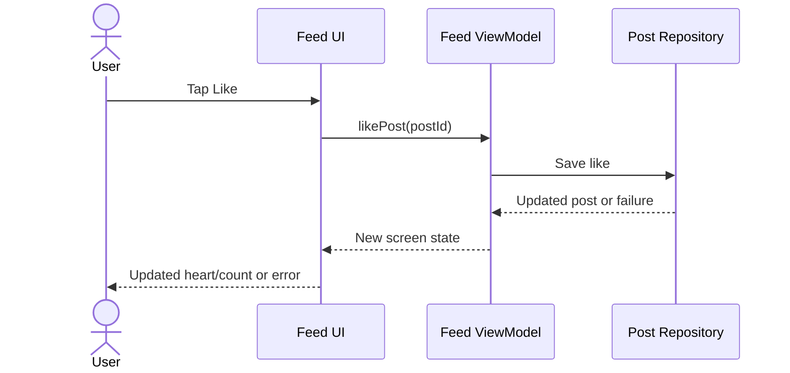

# Phase 5 — Architecture: Why Does MVVM Exist?

> **Topic 1:** Understand the problem before learning the pattern.
>
> **Prerequisites:** Kotlin classes and interfaces, Compose state and callbacks, and Android configuration changes from Phases 1–3.
>
> **Learning outcome:** Explain why growing apps need separate responsibilities, trace a user action through MVVM, and decide where screen state, rendering, and data operations belong.

## Table of Contents

1. [From building screens to organizing behavior](#1-from-building-screens-to-organizing-behavior)
2. [The problem with doing everything in one screen](#2-the-problem-with-doing-everything-in-one-screen)
3. [What MVVM means](#3-what-mvvm-means)
4. [Following a Like action](#4-following-a-like-action)
5. [Connecting MVVM to Compose state](#5-connecting-mvvm-to-compose-state)
6. [A small Kotlin example](#6-a-small-kotlin-example)
7. [Android lifecycle and state ownership](#7-android-lifecycle-and-state-ownership)
8. [How separation improves testing and changes](#8-how-separation-improves-testing-and-changes)
9. [Common misconceptions](#9-common-misconceptions)
10. [Practice and knowledge check](#10-practice-and-knowledge-check)
11. [Interview answer and checkpoint](#11-interview-answer-and-checkpoint)
12. [Official references](#12-official-references)

---

## 1. From building screens to organizing behavior

In Phase 4, you built interfaces inspired by Spotify, WhatsApp, Telegram, and Instagram. You worked on layouts, gestures, animations, and local interactions. Those skills answer this question:

> How do I build a screen that looks and responds the way I want?

Now imagine connecting the Instagram feed to real data. The screen needs to load posts, display progress, handle errors, save likes, and stay consistent when the user revisits it.

This introduces another question:

> Who should own each operation and each piece of state?

**Architecture is the way we assign responsibilities and define how parts of the app communicate.** MVVM is one pattern for organizing those responsibilities.

It becomes useful as the number of behaviors and the cost of changing them grow. A tiny static screen may need very little structure.

## 2. The problem with doing everything in one screen

Consider this deliberately incomplete sketch:

```kotlin
@Composable
fun FeedScreen() {
    // Hold posts, loading status, and error state.
    // Fetch posts from the server.
    // Read and write cached posts.
    // Handle likes and retries.
    // Resolve failures.
    // Draw cards, buttons, and animations.
}
```

The problem is not simply the number of lines. This function now has several unrelated responsibilities.

### 2.1 Too many reasons to change

Suppose you make three product changes:

- Replace square post cards with a different layout.
- Load cached posts before refreshing from the network.
- Show a retry action when a request fails.

The first concerns appearance, the second data access, and the third screen behavior. When all three live together, even a layout change requires navigating around unrelated data code.

### 2.2 Behavior becomes difficult to test

You want to verify: “When loading fails, the screen state contains an error and loading stops.”

If that logic is embedded in a composable alongside real network calls, testing it requires extra UI and service setup. Separating the decision lets you test it with a controllable data source.

### 2.3 Different screens can disagree

Imagine displaying the same post in the feed and on a profile. If each screen independently owns a persistent like count, one can show 11 likes while the other shows 12.

A shared data owner can coordinate updates. MVVM alone does not guarantee consistency; the data layer still needs a deliberate source of truth.

### 2.4 UI lifetime and data lifetime differ

Android can recreate an Activity during a configuration change. A composable can leave the composition. Data loading and screen state need an owner whose lifetime matches the intended behavior.

Moving code into another file helps readability, but **a useful boundary also defines ownership, dependencies, and lifetime**.

## 3. What MVVM means

**MVVM = Model–View–ViewModel.**

| Part | Main question | Instagram example |
|---|---|---|
| Model | What is the application data, and how is it accessed or changed? | Posts, repository, network/database operations, application rules |
| View | How should the current state appear, and what did the user do? | Feed composables, post cards, buttons |
| ViewModel | What state does this screen expose, and how does it respond to actions? | Feed loading state, error state, coordinating a like request |

### Model: the data side

A `Post` data class is part of the Model, but the Model is broader than that class. It includes the behavior that supplies and changes application data.

For example, a repository can provide `loadPosts()` and `likePost(id)`. Its callers do not need to know the database table or server endpoint involved.

Repository design will receive its own topic. For now, think of a repository as the screen logic's entry point to application data.

### View: presentation and interaction

In Compose, the View consists of composables. A post card receives information such as the caption and whether the post is liked. It renders that information and reports actions through callbacks.

Rendering includes genuine UI logic: formatting a label, choosing a layout, and running an animation. Separating responsibilities does not mean a View has no logic whatsoever.

### ViewModel: screen state and coordination

A feed ViewModel can accept a refresh action, request posts, and expose loading, success, or failure state. It coordinates with the data side rather than implementing every database query or networking detail itself.

Android's architecture guide describes UI elements, state holders, and a data layer with these kinds of responsibilities. Modern Android discussions may emphasize layers and unidirectional data flow instead of using the MVVM label. [Guide to app architecture](https://developer.android.com/topic/architecture)

## 4. Following a Like action

Imagine a post with 10 likes. The user taps its heart. Here is a **pessimistic update** design: the visible count changes after the save succeeds.



Step by step:

1. The View reports the post ID that was tapped.
2. The ViewModel starts the operation and can expose a pending state.
3. The repository performs the data update.
4. The ViewModel exposes the resulting screen state.
5. Compose renders the new state.

An **optimistic update** changes the heart immediately and handles a later failure by reverting or reconciling the state. That is a separate product and consistency decision. MVVM provides places to put the behavior; it does not choose the policy for you.

These arrows describe runtime communication. The ViewModel does not need a reference to a composable, button, or Activity to publish state.

## 5. Connecting MVVM to Compose state

You already learned that observable state drives Compose UI. MVVM adds a clear owner for screen-level state.

```kotlin
data class FeedUiState(
    val posts: List<Post> = emptyList(),
    val isLoading: Boolean = false,
    val errorMessage: String? = null
)
```

Think of this object as a description of what the screen currently knows.

| Situation | State | Possible presentation |
|---|---|---|
| Initial load | Loading, no posts | Progress indicator |
| Successful load | Posts available, no error | Feed |
| Successful empty result | No posts, no error, not loading | Empty message |
| Failed initial load | Error, no posts, not loading | Error and retry action |
| Failed refresh | Existing posts plus an error | Keep posts visible and offer retry |

Notice why “an empty list means an error” would be a poor rule: an empty feed can be a successful response.

The interaction loop is:

```text
User action → ViewModel → Data operation → New UI state → UI
```

The View sends an action instead of independently changing shared application data. This makes the update path easier to follow.

## 6. A small Kotlin example

The following snippets illustrate the boundary for **loading posts**. They are teaching snippets, not a complete runnable Android project. Imports, dependency setup, a repository implementation, and ViewModel factory wiring are omitted. Assume Compose Material 3, Lifecycle ViewModel/Compose integration, and Kotlin coroutines are available.

### 6.1 Data contract

```kotlin
data class Post(
    val id: String,
    val caption: String
)

interface PostRepository {
    // Implementations should be safe to call from the main thread.
    suspend fun loadPosts(): List<Post>
}
```

A repository implementation can fetch real data or return a fake list during learning. Marking a function `suspend` does not automatically move blocking work to a background thread; the implementation must handle that correctly.

### 6.2 Screen state owner

Use the `FeedUiState` defined above with this ViewModel:

```kotlin
class FeedViewModel(
    private val repository: PostRepository
) : ViewModel() {

    private val _uiState = MutableStateFlow(FeedUiState())
    val uiState: StateFlow<FeedUiState> = _uiState.asStateFlow()

    init {
        loadPosts()
    }

    fun loadPosts() {
        if (_uiState.value.isLoading) return

        // Mark loading before launching so repeated calls are ignored.
        _uiState.update {
            it.copy(isLoading = true, errorMessage = null)
        }

        viewModelScope.launch {
            try {
                val posts = repository.loadPosts()
                _uiState.update {
                    it.copy(posts = posts, isLoading = false)
                }
            } catch (cancelled: CancellationException) {
                throw cancelled
            } catch (error: Exception) {
                _uiState.update {
                    it.copy(
                        isLoading = false,
                        errorMessage = "Could not load posts. Try again."
                    )
                }
            }
        }
    }
}
```

Read the code by responsibility:

- `_uiState` is mutable inside the ViewModel; callers receive a read-only `StateFlow`.
- `loadPosts()` describes a screen action.
- The repository supplies posts.
- `copy()` creates the next state while preserving existing posts during a failed refresh.
- Cancellation is rethrown so it is not presented as a normal request failure.

The broad failure branch keeps the example small. A larger application can model expected error types and tailor its recovery behavior.

### 6.3 UI boundary

```kotlin
@Composable
fun FeedRoute(viewModel: FeedViewModel) {
    val state by viewModel.uiState.collectAsStateWithLifecycle()

    FeedScreen(
        state = state,
        onRetry = viewModel::loadPosts
    )
}

@Composable
fun FeedScreen(
    state: FeedUiState,
    onRetry: () -> Unit
) {
    Column {
        if (state.isLoading) {
            CircularProgressIndicator()
        }

        state.errorMessage?.let { message ->
            Text(message)
            Button(onClick = onRetry) {
                Text("Retry")
            }
        }

        if (!state.isLoading &&
            state.errorMessage == null &&
            state.posts.isEmpty()
        ) {
            Text("No posts yet")
        }

        LazyColumn {
            items(state.posts, key = { it.id }) { post ->
                Text(post.caption)
            }
        }
    }
}
```

`FeedRoute` connects the state holder to Compose. `FeedScreen` can be shown with a sample state and an empty callback, making previews and UI tests easier.

The caller must obtain `FeedViewModel` through an appropriate ViewModel owner and factory or dependency injection mechanism. Constructing it directly inside a composable on each recomposition would defeat the intended ownership.

## 7. Android lifecycle and state ownership

### MVVM and Jetpack ViewModel are different concepts

MVVM is an architectural pattern. Jetpack `ViewModel` is an Android library class commonly used as its screen state holder. Extending that class is not, by itself, proof that responsibilities are well separated.

A properly scoped Jetpack ViewModel can survive Activity recreation during a configuration change. It is cleared when its owner is permanently removed. It does **not** survive process death. [ViewModel overview](https://developer.android.com/topic/libraries/architecture/viewmodel)

```text
Rotation with Activity recreation:
Old Activity destroyed → Same scoped ViewModel → New Activity observes state

Process death:
In-memory objects lost → New process → Restore small saved state and reload data
```

### Choose ownership based on the state

| Example | Typical owner or mechanism | Reason |
|---|---|---|
| Heart animation progress | Local Compose state/animation object | Concerns a visual element |
| An expanded dropdown | Local UI state, optionally saveable | Usually local presentation behavior |
| Feed loading and error state | Screen ViewModel | Coordinates a screen operation |
| Search query used to load results | Screen state holder, with saved-state support when needed | Influences screen data and may need restoration |
| Saved posts or likes | Repository and persistent storage/server | Application data outlives a screen |

`remember` retains values across recompositions while the relevant composition remains. `rememberSaveable` supports saving eligible UI values for recreation. `SavedStateHandle` can support restoration of small state associated with a ViewModel. These mechanisms do not replace durable storage for application data. [Saving UI state](https://developer.android.com/develop/ui/compose/state-saving)

Avoid moving every animation, scroll operation, or widget flag into a ViewModel. Ask what uses the state and how long it should live.

## 8. How separation improves testing and changes

### Test a decision without drawing a screen

For the loading example, substitute a fake repository with controlled behavior:

| Fake behavior | Expected ViewModel result |
|---|---|
| Returns two posts | Two posts, loading false, no error |
| Returns an empty list | Empty posts, loading false, no error |
| Throws a request failure | Error message, loading false |
| Refresh fails after an earlier success | Previous posts remain available |

These are observable behaviors. A test need not inspect how many private helper functions the ViewModel contains.

### Change appearance independently

Suppose the product changes from a vertical feed to a grid. If the View accepts state and callbacks, the layout can change while the loading behavior stays the same.

### Change the data source behind a contract

During learning, `PostRepository` might return a fake list. Later it might coordinate a server and local cache. Keeping that decision behind the repository prevents UI code from learning database and networking details.

There is still a cost: more boundaries, more wiring, and decisions about ownership. Apply enough structure to make behavior clear; do not create layers that have no useful responsibility.

## 9. Common misconceptions

| Misconception | More accurate understanding |
|---|---|
| Model means only a data class | It includes application data and the behavior around it. |
| ViewModel means all business logic belongs there | It coordinates screen behavior; reusable application rules can belong in the data or optional domain layer. |
| Every composable needs its own ViewModel | Reusable components usually accept state and callbacks. |
| MVVM prevents every lifecycle bug | Correct scope, restoration, and persistence still need design. |
| ViewModel survives app termination | Its in-memory state is lost with the process. |
| MVVM requires XML data binding or LiveData | Compose can render observable state through other mechanisms, including StateFlow. |
| Three folders named model, view, and viewmodel are enough | Actual dependencies and responsibilities determine the architecture. |
| MVVM automatically makes work asynchronous | Concurrency and thread usage still depend on the implementation. |

## 10. Practice and knowledge check

### Exercise 1: Assign responsibilities in your Spotify clone

Choose an owner for each item before opening the answer:

1. Play button size, color, and animation.
2. The selected track ID used by the screen.
3. Loading songs from storage.
4. Showing a retry message after loading fails.

<details>
<summary>Suggested answer</summary>

1. The View owns the visual appearance and animation.
2. A screen state holder can own the screen selection. If it represents actual ongoing playback, the playback component should own that truth and the screen should observe it.
3. A repository/data source handles access to storage.
4. The ViewModel exposes a suitable failure state; the View renders the message and retry button.

A music player's playback lifetime can extend beyond one screen. A screen ViewModel should not become the owner of the entire playback system merely because the player is visible there.

</details>

### Exercise 2: Refactor on paper

Take a Phase 4 screen and list its behaviors. Label each behavior as rendering, local UI interaction, screen coordination, or data access.

Sketch two functions: one that connects to a state holder, and one that receives state plus callbacks. You do not need a server, database, or Hilt setup for this exercise.

### Knowledge check

<details>
<summary>Why is a large composable with networking and rendering difficult to maintain?</summary>

It combines responsibilities with different reasons to change. Testing and modifying one behavior requires navigating dependencies belonging to others.

</details>

<details>
<summary>Does moving every line from an Activity into a ViewModel solve the problem?</summary>

No. A ViewModel containing rendering details, raw database work, networking, and every application rule still mixes responsibilities. The separation must exist in behavior, not just filenames.

</details>

<details>
<summary>Why expose a read-only state stream?</summary>

It directs changes through the state owner's actions instead of allowing callers to modify screen state arbitrarily. This makes the update path easier to reason about.

</details>

<details>
<summary>What happens to feed state when the process dies?</summary>

The in-memory ViewModel and its state disappear. A new instance must rebuild state using persisted data and any suitable restored inputs.

</details>

## 11. Interview answer and checkpoint

> MVVM separates application data and operations, UI rendering, and screen state management. The View displays state and reports actions. The ViewModel handles screen actions and exposes state while coordinating with the Model. This separation makes behavior easier to test and changes easier to isolate. On Android, a properly scoped Jetpack ViewModel also helps retain screen state across configuration changes, but persistence is still required for durable data.

Before continuing, make sure you can:

- [ ] Explain the problem MVVM addresses using your own Phase 4 screen.
- [ ] Describe Model, View, and ViewModel without relying only on their names.
- [ ] Trace a user action through the data operation and back to rendered state.
- [ ] Distinguish local UI state from screen state and persistent application data.
- [ ] Explain why ViewModel retention does not solve process death.
- [ ] Describe one behavior you could test with a fake repository.

**Next learning step:** Implement a small screen with a properly scoped ViewModel, explicit UI state, and a fake repository; then study the Repository pattern in detail.

## 12. Official references

- [Guide to app architecture](https://developer.android.com/topic/architecture) — responsibilities and architectural boundaries.
- [ViewModel overview](https://developer.android.com/topic/libraries/architecture/viewmodel) — Android state holders and their lifetime.
- [State and Jetpack Compose](https://developer.android.com/develop/ui/compose/state) — observable state and state hoisting.
- [Saving UI state in Compose](https://developer.android.com/develop/ui/compose/state-saving) — saveable state and restoration.

[Back to the course roadmap](../../README.md)
