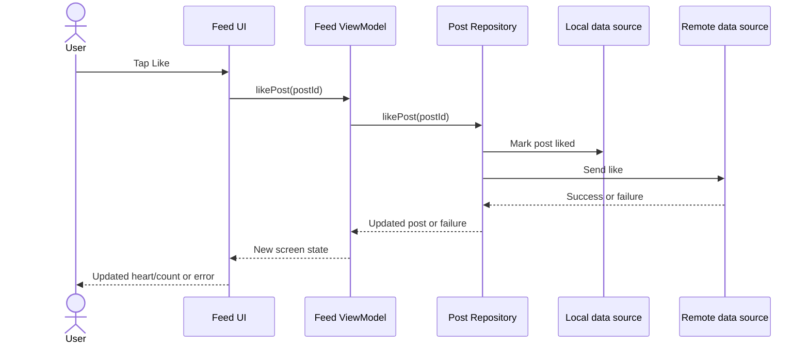

# Phase 5 — Architecture: The Repository Pattern

> **Topic 2:** Give application data one clear owner, so screens do not have to know where data comes from.
>
> **Prerequisites:** Topic 1 (Why Does MVVM Exist?), Kotlin classes and interfaces, suspend functions, and Compose state from Phases 1–3.
>
> **Learning outcome:** Explain what a repository is, design a repository contract, choose a caching strategy, trace a data operation through the data layer, and test screen behaviour with a fake repository.

## Table of Contents

1. [Why the ViewModel needs a data boundary](#1-why-the-viewmodel-needs-a-data-boundary)
2. [What a repository is](#2-what-a-repository-is)
3. [Single source of truth](#3-single-source-of-truth)
4. [The repository contract](#4-the-repository-contract)
5. [Following a Like action through a repository](#5-following-a-like-action-through-a-repository)
6. [Data sources and caching strategies](#6-data-sources-and-caching-strategies)
7. [A small Kotlin example](#7-a-small-kotlin-example)
8. [Repository, data source, DAO, and UseCase — where each belongs](#8-repository-data-source-dao-and-usecase--where-each-belongs)
9. [Common misconceptions](#9-common-misconceptions)
10. [Practice and knowledge check](#10-practice-and-knowledge-check)
11. [Interview answer and checkpoint](#11-interview-answer-and-checkpoint)
12. [Official references](#12-official-references)

---

## 1. Why the ViewModel needs a data boundary

In Topic 1, the feed ViewModel depended on a `PostRepository` interface, but the repository itself was left as a placeholder. Now consider what happens if that boundary is missing:

```kotlin
class FeedViewModel : ViewModel() {
    // Fetch posts from the server.
    // Read and write cached posts.
    // Handle retries and offline cases.
    // Expose loading, success, and error state.
}
```

The ViewModel now has several unrelated reasons to change:

- Replace the server endpoint or its response format.
- Load cached posts before refreshing from the network.
- Add a local database, or change how likes are stored.
- Change how a failed refresh is handled.

The first two concerns are about data access, the last two are about screen behaviour and persistence. When they live together, a data change forces you to edit screen code, and a screen change forces you to navigate around networking and database code.

There is a second problem. If the feed screen and the profile screen each fetch and store likes independently, they can disagree: one shows 11 likes, the other shows 12. Neither screen is wrong about its own copy — there was simply no shared owner for that data.

**The repository is that shared owner.** It sits between screen logic and data sources, and it decides how data is obtained, combined, saved, and exposed.

## 2. What a repository is

A repository is a class, usually exposed through an interface, that:

- Exposes data to the rest of the app.
- Centralizes changes to that data.
- Resolves conflicts between multiple data sources.
- Abstracts data sources from the rest of the app.
- Contains the data-layer business logic for that data type.

Repositories are normally named after the data they own: `PostRepository`, `UserRepository`, `MessageRepository`. Callers depend on the interface, not on a particular implementation.

| Part | Main question | Instagram example |
|---|---|---|
| View | How should the current state appear, and what did the user do? | Feed composables, post cards, buttons |
| ViewModel | What state does this screen expose, and how does it respond to actions? | Feed loading state, error state, coordinating a like request |
| Repository | Where does this data come from, and how is it kept consistent? | Posts from cache, server, or both; saving a like |
| Data source | How is one specific store or service accessed? | A network API, a Room database, a file, an in-memory cache |

A repository is not a database, and it is not a network client. It may use both, but its job is coordination and ownership, not the low-level details of a single store.

> A useful test for the boundary: if the app switches from one server to another, or from a fake list to a real database, the ViewModel and the composables should not need to change.

## 3. Single source of truth

**Single source of truth (SSOT)** means that for each type of data, one owner is authoritative, and every screen reads from that owner.

For posts, that owner is the post repository. The feed and the profile do not each keep their own liked state. They observe, or request, the same post data through the same repository.

```text
Feed screen ──┐
              ├─→ PostRepository ──→ authoritative post data
Profile screen ┘
```

Without SSOT, updates have to be copied between screens, and copies drift apart. With SSOT, a like saved through the repository is visible to every screen that reads from it, once that screen observes the updated data.

SSOT does not mean that data lives in only one physical place. A repository can keep a copy in a local cache and another copy on a server. It means there is one place that decides which copy is authoritative, when copies are refreshed, and how conflicts are resolved.

That decision is a product decision as well as a technical one:

- Should a like appear immediately, even before the server confirms it?
- Should a failed refresh keep showing cached posts, or replace them with an error?
- How old may cached posts be before they are considered stale?

The repository is where those answers are implemented, so screens do not each invent their own.

## 4. The repository contract

A contract is the interface that callers use. It should describe *what* the app needs, in the app's own terms, not *how* a server or database works.

```kotlin
data class Post(
    val id: String,
    val caption: String,
    val isLiked: Boolean = false
)

interface PostRepository {
    // Implementations should be safe to call from the main thread.
    suspend fun loadPosts(): List<Post>
    suspend fun likePost(postId: String)
}
```

Read the contract by what it hides:

- Callers do not know whether `loadPosts()` reads a cache, a database, or a server.
- Callers do not know the server endpoint, the database table, or the response format.
- Callers do not need to know whether a like is stored locally first, remotely first, or both.

That hiding is the point. It lets the data implementation change while the ViewModel keeps the same code, and it lets tests substitute a fake implementation with controlled behaviour.

### One-shot operations and observable data

Android's data layer exposes two kinds of operations:

| Kind | Kotlin form | When to use it |
|---|---|---|
| One-shot | `suspend fun loadPosts(): List<Post>` | Load once, for example on refresh or on a button press |
| Observable | `fun observePosts(): Flow<List<Post>>` | Keep watching, so every screen updates when the data changes |

Topic 1 used a one-shot operation, because it was enough to teach the ViewModel boundary. A repository that returns a `Flow` is the natural next step when cached data can change underneath the screen — for example, when a like is saved on one screen and should appear on another. You will study `Flow` in depth in Phase 8; for now, treat it as "a stream of values over time" rather than a single answer.

Do not expose database entities or network response objects through the repository contract. The repository owns the mapping from those storage shapes to the `Post` model the rest of the app uses. If a server field is renamed, the mapping changes in one place, not in every screen.

### Main safety and errors

As in Topic 1, marking a function `suspend` does not automatically move blocking work to a background thread. Repository implementations must be main-safe: Room and Retrofit suspend functions already handle this for their own work, but custom blocking code needs an appropriate dispatcher, such as `Dispatchers.IO`.

Similarly, a repository should not leak low-level failures into screen code. A ViewModel should not have to understand a specific HTTP error or database exception to decide what the screen shows. The repository decides the data policy — return cached data, retry, or surface a failure — and the ViewModel decides the screen state, as in Topic 1.

## 5. Following a Like action through a repository

Imagine a post with 10 likes. The user taps its heart. Here is a design in which the local copy is updated first, so the app stays consistent even before the server replies:



Step by step:

1. The View reports the post ID that was tapped.
2. The ViewModel starts the operation and can expose a pending state.
3. The repository updates the local copy, so every screen reading from it agrees.
4. The repository sends the like to the server.
5. If the server call fails, the repository must decide the policy: keep the local change and retry later, or revert it and report a failure. That decision should not be invented separately by each screen.
6. The ViewModel exposes the resulting screen state, and Compose renders it.

This is the same Like flow as Topic 1, with one important difference: Topic 1 stopped at "the repository performs the data update." This topic explains what that update actually involves, and who owns each part of it.

An **optimistic update** changes the heart immediately and reconciles a later failure. A **pessimistic update** waits for the save to succeed before changing the visible count. The repository pattern supports both; it does not choose the policy for you. The policy belongs in the repository, where it is applied consistently.

## 6. Data sources and caching strategies

A data source knows how to talk to one store or service. A repository knows how to combine them.

```text
PostRepository
├── PostRemoteDataSource   → server API (Retrofit in Phase 7)
├── PostLocalDataSource    → local database (Room in Phase 6)
└── In-memory cache       → fast, but lost when the process dies
```

### Choosing a strategy

There is no single correct caching strategy. The right choice depends on what the product needs: speed, freshness, offline support, and tolerance for stale data.

| Strategy | How it works | Good for | Watch out for |
|---|---|---|---|
| Network-only | Always fetch from the server | Data that must be fresh; simple to reason about | No offline support; slow on poor networks |
| Cache-first | Return cached data if present; fetch only on a miss | Fast startup; offline support | Data can be stale; needs an expiry or refresh rule |
| Network-first | Fetch fresh data; fall back to cache on failure | Fresh when online; still usable offline | Slower first load; cache may be stale after a failure |
| Cache-then-network | Show cached data immediately, then refresh in the background | Best perceived speed; good offline-first feel | Needs observable data, such as a `Flow`, so the refresh reaches the screen; more complex |

A common offline-first shape is: the local database is the authoritative cache for reads, the server refreshes that cache, and every write goes through the repository so both copies stay in sync. You will build the Room and networking pieces for this in Phases 6 and 7. The repository design in this topic is what makes those later pieces fit together without rewriting the screens.

Two mistakes are worth naming early:

- **No expiry rule.** Cache-first without a freshness rule means a user can see last week's feed forever. Decide when cached data is too old, even if the rule starts as simply as "refresh on pull-to-refresh."
- **Writes that bypass the repository.** If one screen writes directly to the database and another writes through the repository, the single source of truth is gone. Every write path for a data type should pass through its repository.

## 7. A small Kotlin example

The following snippets illustrate the boundary for **loading and liking posts**. They are teaching snippets, not a complete runnable Android project. Imports, dependency setup, Room and Retrofit wiring, and ViewModel factory or Hilt setup are omitted. Assume Kotlin coroutines are available.

### 7.1 Data sources

Each data source owns one store. Neither knows about screens, ViewModels, or the other store:

```kotlin
interface PostRemoteDataSource {
    suspend fun fetchPosts(): List<Post>
    suspend fun sendLike(postId: String)
}

interface PostLocalDataSource {
    suspend fun getPosts(): List<Post>
    suspend fun savePosts(posts: List<Post>)
    suspend fun markLiked(postId: String)
}
```

In a real app, the remote source would map a network response to `Post`, and the local source would map a database entity to `Post`. Those mappings live in the data layer, not in the ViewModel.

### 7.2 A cache-first repository

```kotlin
class PostRepositoryImpl(
    private val remote: PostRemoteDataSource,
    private val local: PostLocalDataSource
) : PostRepository {

    override suspend fun loadPosts(): List<Post> {
        val cached = local.getPosts()
        if (cached.isNotEmpty()) return cached

        val fresh = remote.fetchPosts()
        local.savePosts(fresh)
        return fresh
    }

    override suspend fun likePost(postId: String) {
        local.markLiked(postId)
        remote.sendLike(postId)
    }
}
```

Read the code by responsibility:

- `loadPosts()` implements a cache-first policy: cached data wins on a hit, the network fills a miss, and the result is saved for next time.
- `likePost()` updates the local copy first, then the server, so screens reading from the local copy agree immediately.
- The ViewModel does not know, or care, which branch ran.

This sketch is deliberately incomplete as a production implementation. It has no cache expiry, no refresh action, and no rollback if `sendLike()` fails. Those are real decisions to add next, not details to hide. A repository that pretends those decisions do not exist will make them implicitly, in the worst place: inside screen code.

### 7.3 A fake repository for learning and testing

```kotlin
class FakePostRepository : PostRepository {

    private val posts = mutableListOf(
        Post(id = "1", caption = "First post"),
        Post(id = "2", caption = "Second post")
    )

    override suspend fun loadPosts(): List<Post> = posts.toList()

    override suspend fun likePost(postId: String) {
        val index = posts.indexOfFirst { it.id == postId }
        if (index != -1) {
            posts[index] = posts[index].copy(isLiked = true)
        }
    }
}
```

The fake returns a copy of its list, so callers cannot mutate its internal state directly. All changes go through `likePost()`, just as they would with a real implementation.

### 7.4 The ViewModel does not change

Topic 1's ViewModel already depended only on the interface:

```kotlin
class FeedViewModel(
    private val repository: PostRepository
) : ViewModel()
```

Swapping `FakePostRepository` for `PostRepositoryImpl` changes no ViewModel code. That is the practical payoff of the contract: the screen logic is written once, and the data implementation can grow from a fake list, to a cache, to a server-backed store, without rewriting the screen.

The caller must still obtain the ViewModel through an appropriate ViewModel owner and factory or dependency injection mechanism. Constructing it directly inside a composable on each recomposition would defeat the intended ownership. Hilt wiring for this is covered later in Phase 5.

## 8. Repository, data source, DAO, and UseCase — where each belongs

These four names are often confused, because they all sit below the ViewModel. They are not interchangeable.

| Component | Owns | Example |
|---|---|---|
| Data source | One store or service | A Retrofit API interface, a Room DAO, a file reader |
| DAO | Database access for one entity | `PostDao` with queries for the posts table |
| Repository | Coordination, caching, and consistency for one data type | `PostRepository`, combining the API and the DAO |
| UseCase (optional) | A reusable rule that may span repositories | "Like a post and record the interaction" across posts and analytics |

Guidelines that keep the layers honest:

- A ViewModel should not call a DAO or a Retrofit API directly. If it does, the repository boundary has been bypassed.
- A repository should not contain composables, navigation, or screen state. If it does, screen logic has leaked into the data layer.
- A data source should not coordinate another data source. If it does, it has quietly become a repository.
- A UseCase is not required for every repository call. Create one when a rule is reused across screens, or when it genuinely combines more than one repository. Wrapping every single repository method in its own UseCase adds a layer with no useful responsibility.

Clean Architecture, which Phase 5 covers after this topic, formalizes these boundaries further, with a domain layer between the UI and data layers. The repository pattern is the data-layer half of that picture: it is useful on its own, and it is also the foundation the domain layer will depend on.

## 9. Common misconceptions

| Misconception | More accurate understanding |
|---|---|
| A repository is just a wrapper around an API | It owns caching, consistency, and coordination across sources, not just one network call. |
| A repository is the same as a DAO | A DAO accesses one database table. A repository can combine a DAO, an API, and a cache. |
| Every screen needs its own repository | Repositories are owned per data type, not per screen. Screens share them. |
| Repository pattern automatically gives offline support | Offline support comes from a caching strategy and local storage, which the repository must actually implement. |
| A repository should return database entities or API responses | It should return the app's own model, mapping storage shapes inside the data layer. |
| Adding a repository fixes every inconsistency | Only if every read and write for that data goes through it. A bypassed repository is not a single source of truth. |
| A repository must always use a database | A repository with a single network source is still useful: it centralizes access, mapping, and error policy. |
| Flow is required for a repository | One-shot `suspend` functions are fine for one-shot operations. `Flow` is for data that changes over time. |
| The ViewModel should handle cache expiry | Expiry and freshness are data policies. They belong in the repository, not in screen code. |
| More layers are always better | Each layer needs a useful responsibility. A layer that only forwards calls is a cost, not an improvement. |

## 10. Practice and knowledge check

### Exercise 1: Assign responsibilities

Choose an owner for each item before opening the answer:

1. The HTTP endpoint and response format for posts.
2. The SQL query for the posts table.
3. Deciding whether to show cached posts or fetch fresh ones.
4. Deciding what the feed screen shows while posts load.
5. Recording a like so the feed and profile agree.

<details>
<summary>Suggested answer</summary>

1. The remote data source owns the endpoint and response format.
2. The DAO, as the local data source, owns the SQL query.
3. The repository owns the caching strategy.
4. The ViewModel owns the loading state; the View renders it.
5. The repository owns the like, so every screen reading from it agrees.

If you assigned item 3 or 5 to the ViewModel, the same decision would have to be repeated — and kept consistent — in every screen that shows posts.

</details>

### Exercise 2: Design a caching strategy on paper

For each case, choose a strategy from Section 6 and state one tradeoff:

1. Opening the feed on a slow network, where last week's posts are worse than a short wait.
2. Opening the feed offline, where yesterday's posts are better than an error screen.
3. A profile screen showing the user's own liked posts.

<details>
<summary>Suggested answer</summary>

1. Network-first: freshness matters more than instant display, and a cache fallback still helps if the network fails.
2. Cache-first, or cache-then-network: something useful must appear offline, even if it may be stale.
3. Cache-first with a refresh on open, or cache-then-network: the user's own data should feel immediate, and it should still refresh when online.

There is no universally correct answer here. The exercise is to make the tradeoff explicit, in the repository, rather than accidental, in each screen.

</details>

### Exercise 3: Refactor on paper

Take a ViewModel that calls a network API directly. Sketch, without a server or database:

1. A `PostRepository` interface with `loadPosts()` and `likePost()`.
2. A fake implementation you could test with.
3. The one line in the ViewModel that changes: its constructor now takes the interface instead of the API client.

You do not need Retrofit, Room, or Hilt setup for this exercise. The boundary is the lesson.

### Knowledge check

<details>
<summary>Why should a ViewModel not call a Retrofit API or a Room DAO directly?</summary>

Because then every screen that needs posts repeats data decisions — caching, mapping, error handling, and consistency — and changing the data source means changing screen code. A repository centralizes those decisions behind one contract.

</details>

<details>
<summary>What does single source of truth actually require?</summary>

One authoritative owner per data type, and every read and write for that data going through that owner. Storing a copy in a cache and a copy on a server does not break SSOT, as long as the repository decides which copy is authoritative.

</details>

<details>
<summary>Does a cache-first repository guarantee fresh data?</summary>

No. It guarantees fast, available data. Freshness needs an additional rule: expiry, a refresh trigger, or a cache-then-network update.

</details>

<details>
<summary>When is a UseCase worth adding on top of a repository?</summary>

When a rule is reused across screens, or when it genuinely combines more than one repository. A UseCase that only forwards one repository call adds a layer with no useful responsibility.

</details>

<details>
<summary>What breaks if one screen writes directly to the database?</summary>

The repository is no longer the single source of truth for that data. Other screens may keep showing stale data, and the repository's caching and consistency logic is bypassed for that write.

</details>

## 11. Interview answer and checkpoint

> A repository is the data layer's single entry point for one type of data. It exposes a contract — such as loading posts and liking a post — while hiding whether the data comes from a cache, a database, or a network. It coordinates multiple data sources, implements the caching strategy, maps storage shapes to the app's model, and keeps every screen reading from the same source of truth. That separation lets the ViewModel stay focused on screen state, makes the data implementation swappable, and makes screen behaviour testable with a fake repository.

Before continuing, make sure you can:

- [ ] Explain why a ViewModel calling an API directly becomes hard to change and test.
- [ ] Define a repository contract without mentioning a specific server or database.
- [ ] Explain single source of truth using the feed and profile screens.
- [ ] Compare cache-first, network-first, and cache-then-network, including one tradeoff for each.
- [ ] Trace a Like action from the View through the ViewModel and repository to its data sources.
- [ ] Describe what a fake repository lets you test, without drawing a screen.
- [ ] Distinguish a repository from a data source, a DAO, and a UseCase.

**Next learning step:** Study UseCases and Clean Architecture — where reusable application rules live, and how the domain layer sits between the UI layer and the repositories you have just designed.

## 12. Official references

- [Guide to app architecture](https://developer.android.com/topic/architecture) — responsibilities, layers, and architectural boundaries.
- [Add repository and Manual DI](https://developer.android.com/codelabs/basic-android-kotlin-compose-add-repository) — building a repository and wiring it without a DI framework.
- [ViewModel overview](https://developer.android.com/topic/libraries/architecture/viewmodel) — Android state holders and their lifetime, from Topic 1.

[Back to the course roadmap](../../README.md)
